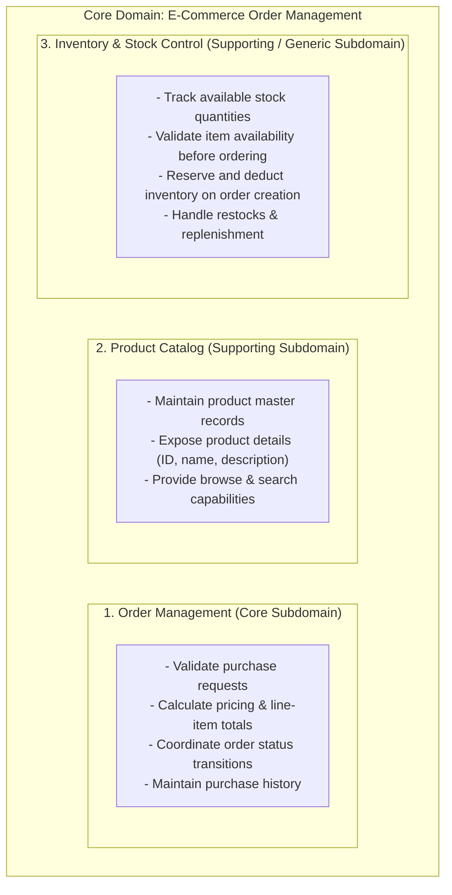
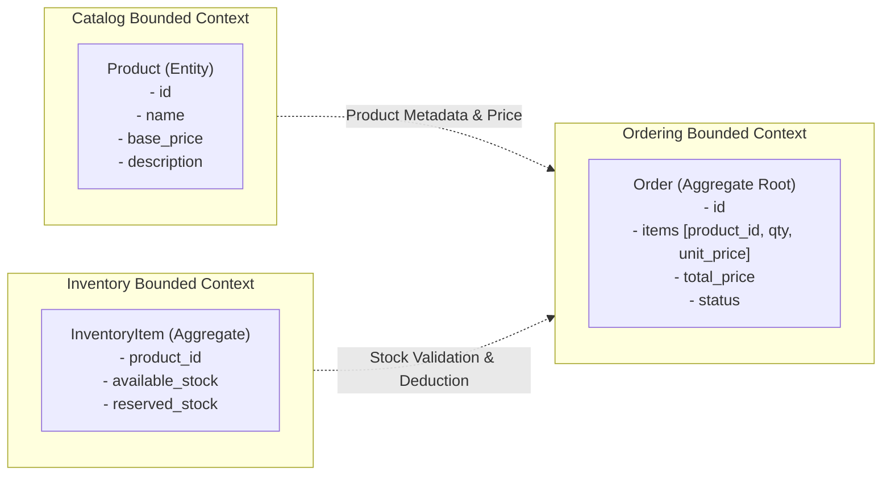
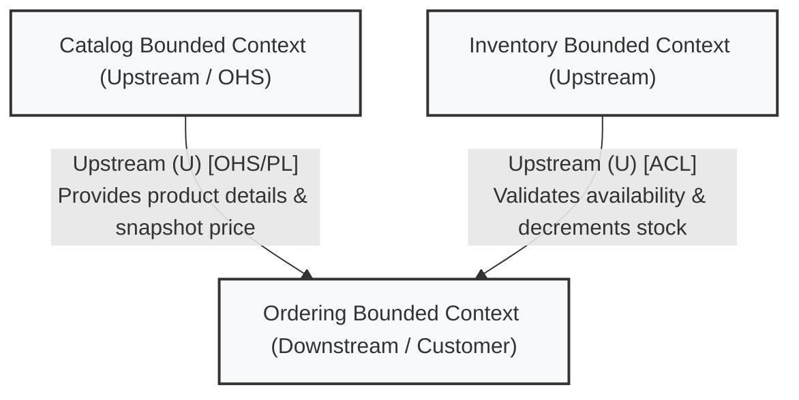

# Domain-Driven Design (DDD) Analysis: MiniOrder System

This document outlines the Domain-Driven Design (DDD) strategic and tactical decomposition for the **MiniOrder** application, answering key architectural and domain questions with diagrams and specifications.

---

## 1. Primary Domain of the System

The primary domain of the system is:
**E-Commerce Order Management & Product Fulfillment (MiniOrder)**.

### Purpose and Value Proposition
The system automates the digital retail workflow: enabling customers to browse available merchandise, place verified orders with quantity specifications, enforce pricing and availability validation, and track order fulfillment states through its business lifecycle.

---

## 2. Subdomains and Their Responsibilities

In DDD, subdomains categorize different aspects of business capability. For MiniOrder, we identify three distinct subdomains:



### Detailed Breakdown:
1. **Order Management Subdomain (Core Subdomain):**
   - **Classification:** Core Domain (drives competitive business logic and direct customer transactions).
   - **Responsibilities:** Ingests order requests, validates business rules for order placement, aggregates item costs, issues unique order IDs, tracks order lifecycle statuses (`created`, `confirmed`, `cancelled`, etc.), and persists order records.

2. **Product Catalog Subdomain (Supporting Subdomain):**
   - **Classification:** Supporting Domain.
   - **Responsibilities:** Manages the product definition, product metadata (names, specifications, display pricing), and delivers read-heavy queries for clients to view items for sale.

3. **Inventory & Stock Management Subdomain (Supporting / Generic Subdomain):**
   - **Classification:** Generic / Supporting Domain.
   - **Responsibilities:** Maintains accurate physical/virtual count of sellable units (`stock`), verifies whether an incoming request quantity can be fulfilled, and manages reservation, decrements, and inventory replenishment.

---

## 3. Ubiquitous Language Glossary (Key Domain Terms)

A consistent Ubiquitous Language aligns developers, domain experts, and code models. Below are six essential terms defined for the MiniOrder domain:

| # | Term | Contextual Definition | Example in System |
|---|---|---|---|
| 1 | **Product** | A commercially offered item within the catalog that carries a distinct identifier, name, base unit price, and product specifications. | `{"id": 1, "name": "Notebook", "price": 50000}` |
| 2 | **Order** | A confirmed commercial transaction agreement initiated by a customer to purchase one or more items under agreed pricing and quantity terms. | `{"id": 1, "product_id": 1, "quantity": 2, "total_price": 100000, "status": "created"}` |
| 3 | **Stock / Available Quantity** | The real-time non-negative integer count of product units physically or virtually held that are available for immediate allocation and sale. | `stock: 10` for Notebook |
| 4 | **Stock Reservation / Allocation** | The operation of verifying that `requested_quantity <= available_stock` and immediately decrementing or locking that quantity to prevent overselling. | Checked during `create_order` |
| 5 | **Order Status** | The explicit state marker defining the current stage of an Order's lifecycle (e.g., `created`, `paid`, `fulfilled`, `cancelled`). | `"status": "created"` |
| 6 | **Line Item Price / Total Price** | The calculated monetary value computed by multiplying an item's unit price at the exact moment of order placement by the ordered quantity (`unit_price * quantity`). | `50000 * 2 = 100000` |

---

## 4. Proposed Bounded Contexts & Boundary Rationale

We propose partitioning the system into three Bounded Contexts:



### Boundary Rationale:
1. **Catalog Bounded Context:**
   - *Model focus:* Read-heavy marketing and commercial presentation of goods.
   - *Why isolated:* Product descriptions, classifications, and marketing metadata change independently of transactional order rules and warehouse counts.

2. **Inventory Bounded Context:**
   - *Model focus:* High-contention transactional consistency of item quantities (stock decrement, replenishment, warehouse locations).
   - *Why isolated:* In the current starter code, `stock` is coupled with `PRODUCTS`. However, inventory logic requires separate concurrent locks, replenishment policies, and physical warehouse tracking that do not belong in a customer-facing catalog.

3. **Ordering Bounded Context:**
   - *Model focus:* Customer purchasing lifecycle, price locking, and contract fulfillment.
   - *Why isolated:* An order captures an immutable snapshot of what the customer agreed to buy at that exact timestamp (price, quantity). Once an order is created, changes to the catalog price or future stock fluctuations must not retroactively mutate past order records.

---

## 5. Context Map & Relationship Diagram

The Context Map visualizes organizational and data relationships among the bounded contexts:



### Strategic Relationship Patterns:
- **Catalog $\rightarrow$ Ordering (Upstream / Downstream with Open Host Service / Published Language):**
  - The Catalog context acts as an **Upstream (U)** provider, exposing stable query contracts (`GET /products/{id}`) representing the Published Language.
  - The Ordering context is **Downstream (D)**; it consumes product metadata to validate existence and snapshot current pricing at the moment of order placement.
- **Inventory $\rightarrow$ Ordering (Customer-Supplier / Anti-Corruption Layer):**
  - Inventory is **Upstream (U)**, managing the authoritative stock levels.
  - Ordering is **Downstream (D)**. An Anti-Corruption Layer (ACL) or domain service in Ordering translates inventory verification responses (e.g., reserving quantity) into domain-safe decisions without tightly coupling order domain models to warehouse storage schemas.

---

## 6. Identified Ambiguities in Problem Specification & Clarifying Questions

Analyzing the initial codebase (`app/main.py`, `app/catalog.py`, `app/orders.py`) reveals two critical domain and operational ambiguities:

### Ambiguity 1: Stock Concurrency & Inventory Reservation Lifecycle
- **The Issue:** The current `create_order` checks `quantity > product["stock"]`, but it **never actually decrements the stock** in `PRODUCTS`. Furthermore, there is no transactional locking or reservation mechanism, meaning multiple concurrent order requests can easily oversell the same inventory.
- **Clarifying Question to Product Owner / Stakeholder:**
  > *"When an order is created, should stock be immediately and permanently decremented, or should it enter a temporary 'reserved' state with a timeout (e.g., 15 minutes to complete payment) before being permanently deducted or released on cancellation?"*

### Ambiguity 2: Multi-Item Orders and Price Invariance (Historical Auditing)
- **The Issue:** The current API schema accepts only a single `product_id` and `quantity` (`OrderRequest`), and references the live `product["price"]`. It is unspecified whether future iterations require multi-product carts and how price changes in the catalog affect existing or in-flight orders.
- **Clarifying Question to Product Owner / Stakeholder:**
  > *"Must the ordering model support multi-item line orders in the upcoming sessions, and do we require an immutable snapshot of item prices recorded on each line item to ensure past orders remain audit-accurate when catalog prices update?"*

---

## 7. Should Every Bounded Context Become an Independent Microservice?

### Answer:
**No, absolutely not.** A Bounded Context is a *strategic domain modeling boundary*, whereas a Microservice is a *physical deployment and runtime architecture boundary*.

```mermaid
flowchart LR
    subgraph Conceptual ["DDD Strategic Modeling"]
        BC1["Catalog Bounded Context"]
        BC2["Inventory Bounded Context"]
        BC3["Ordering Bounded Context"]
    end

    Conceptual -->|Option A: Modular Monolith<br/>(Logical separation, unified process)| App1["Single Application Process<br/>- package: app.catalog<br/>- package: app.inventory<br/>- package: app.orders<br/>(One deployment, zero network tax)"]
    
    Conceptual -->|Option B: Microservices<br/>(Physical network separation)| App2["Distributed Infrastructure<br/>- Catalog Microservice (Docker)<br/>- Inventory Microservice (Docker)<br/>- Order Microservice (Docker)<br/>(Requires API Gateway, Event Bus)"]
```

### Detailed Rationale:
1. **Bounded Context $\neq$ Microservice:**
   - A Bounded Context defines where a ubiquitous language and domain model remain coherent and unambiguous.
   - You can implement multiple bounded contexts inside a **Modular Monolith** as separate Python packages or modules (e.g., `app.catalog`, `app.inventory`, `app.orders`).

2. **Premature Distribution Tax (Distributed Fallacies):**
   - Splitting every context into a microservice immediately introduces network latency, serialization overhead, partial failures, distributed transactions (two-phase commit or saga pattern), and complex deployment/observability pipelines.

3. **Guideline for Splitting into Microservices:**
   A Bounded Context should only be extracted into an independent microservice when driven by clear non-functional or organizational requirements:
   - **Different Scaling Profiles:** e.g., Catalog receives 10,000 queries/sec while Ordering receives 5 orders/sec.
   - **Independent Release & Team Autonomy:** Distinct engineering teams needing to deploy without coordinating release cadences.
   - **Conflicting Technical Requirements:** e.g., One context requires high-performance Go/Rust or a specialized graph database, while another uses Python and relational SQL.
   - **Isolated Failure Domains:** Preventing high-risk experiments or auxiliary modules from crashing core revenue-generating transaction flows.

For MiniOrder, maintaining a **Modular Monolith** with clean internal DDD boundaries is the recommended starting architecture.
