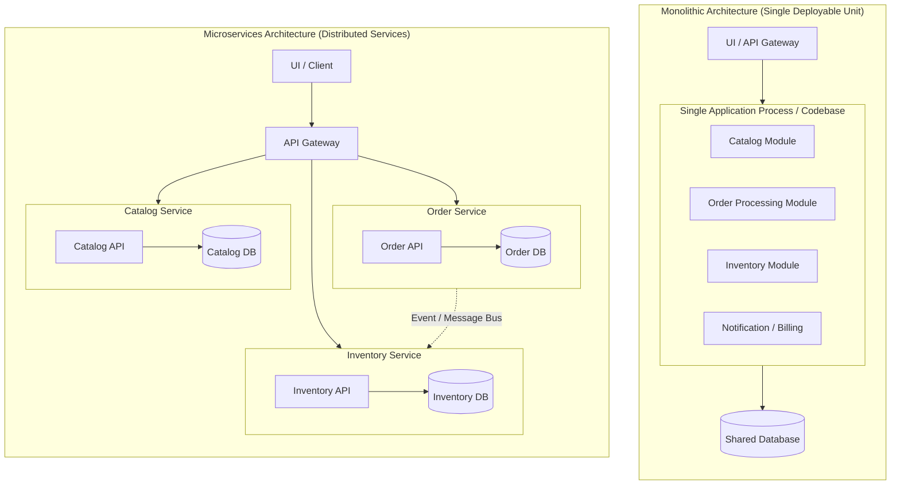

# Microservices vs Monolithic Architecture

This document provides a comparative analysis between **Monolithic Architecture** (specifically *Modular Monoliths*) and **Microservices Architecture**, framed within the context of software engineering and Domain-Driven Design (DDD).

---

## 1. Overview of Architectural Paradigms

---

## 2. Monolithic Architecture

A **Monolith** is an architectural pattern where all software components, business modules, and layers (presentation, business logic, data access) are packaged and deployed together as a **single runnable process / executable unit**.

### Modular Monolith (A Clean Approach)
A *modular monolith* structures the internal codebase into well-defined, decoupled domain boundaries (modules/packages) following DDD principles, while maintaining a single deployment artifact and runtime process.

### Advantages
- **Simplicity of Development & Debugging:** Running, stepping through code, and testing end-to-end requires no complex distributed networking or multiple containers.
- **Transactional Consistency (ACID):** Cross-module workflows can easily rely on local in-memory calls and single database transactions without needing distributed consensus or saga patterns.
- **Lower Operational Overhead:** Requires minimal infrastructure (single CI/CD pipeline, single server/container, no service mesh or complex distributed tracing).
- **High Performance for Inter-Module Calls:** Communication between domains happens via local function/method calls in memory rather than HTTP/gRPC network overhead.

### Disadvantages
- **Tight Coupling Risks:** Without strong discipline, boundaries easily erode into "spaghetti code" or a Big Ball of Mud.
- **Single Point of Failure:** A fatal runtime crash or memory leak in one module can crash the entire application process.
- **Coarse-Grained Scaling:** Scaling requires replicating the entire application, even if only one specific endpoint/module is bottlenecked.
- **Unified Tech Stack:** All modules must conform to the same programming language, runtime, and primary framework.

---

## 3. Microservices Architecture

A **Microservices Architecture** structures an application as a collection of small, autonomous, loosely coupled services. Each service models a specific **Bounded Context**, maintains its own private data store (*Database-per-Service* pattern), and communicates via network protocols (HTTP REST, gRPC, or asynchronous message brokers).

### Advantages
- **Independent Deployability:** Teams can deploy, update, and rollback individual services without coordinating releases across the entire organization.
- **Targeted & Independent Scalability:** High-demand services (e.g., product catalog browsing) can scale out dynamically without allocating extra resources to low-demand services (e.g., checkout/order creation).
- **Fault Isolation:** A failure or performance degradation in an auxiliary service does not bring down the entire system.
- **Technology Diversity:** Teams can choose the optimal programming language, database engine, and runtime suited for each specific bounded context.
- **Organizational Alignment:** Maps naturally to autonomous, cross-functional engineering teams (Conway's Law).

### Disadvantages
- **Distributed System Complexity:** Introduces network latency, partial failures, circuit breakers, and network partitioning challenges.
- **Data Consistency Challenges:** Replaces simple ACID transactions with eventual consistency, two-phase commits, or complex Saga orchestration/choreography patterns.
- **Operational & Infrastructure Overhead:** Requires container orchestration (Kubernetes), distributed tracing (OpenTelemetry, Jaeger), centralized logging, service discovery, and complex CI/CD matrices.
- **Complex Testing:** Comprehensive integration and end-to-end testing across asynchronous, network-separated components is significantly harder.

---

## 4. Key Comparison Summary

| Metric / Dimension | Monolithic Architecture (Modular) | Microservices Architecture |
|---|---|---|
| **Deployment Unit** | Single executable / container / process | Multiple independently deployed services |
| **Communication** | In-memory function/method calls | Network protocols (HTTP, gRPC, Message Broker) |
| **Data Storage** | Shared database or schema-separated DB | Database-per-service (strictly private data stores) |
| **Transaction Model** | ACID transactions (immediate consistency) | Eventual consistency (Saga pattern, Outbox pattern) |
| **Scalability** | Scale the whole instance vertically/horizontally | Granular, per-service horizontal autoscaling |
| **Operational Complexity**| Low (standard deployment, simple logs) | Very high (Kubernetes, distributed tracing, service mesh) |
| **Team Structure** | Best for small-to-medium teams (< 15-20 devs) | Best for large organizations with multiple independent teams |
| **Failure Blast Radius** | High (process crash affects all features) | Low (isolated per service, degraded modes available) |

---

## 5. Architectural Recommendation for MiniOrder

For the **MiniOrder** educational project:
- Starting as a **Modular Monolith** is the optimal design choice.
- It enables mastering **Domain-Driven Design (DDD)** concepts, defining domain boundaries, and modeling bounded contexts without incurring distributed systems tax (network unreliability, serialization overhead, and distributed debugging).
- Clear internal module boundaries allow transitioning to microservices later when scaling or organizational needs genuinely require it.
